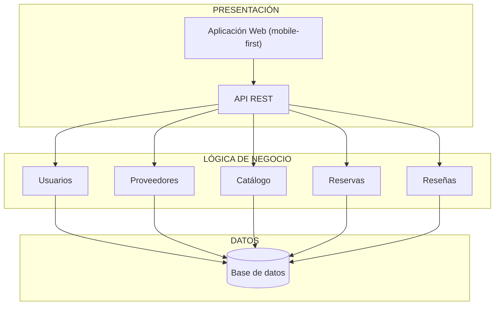
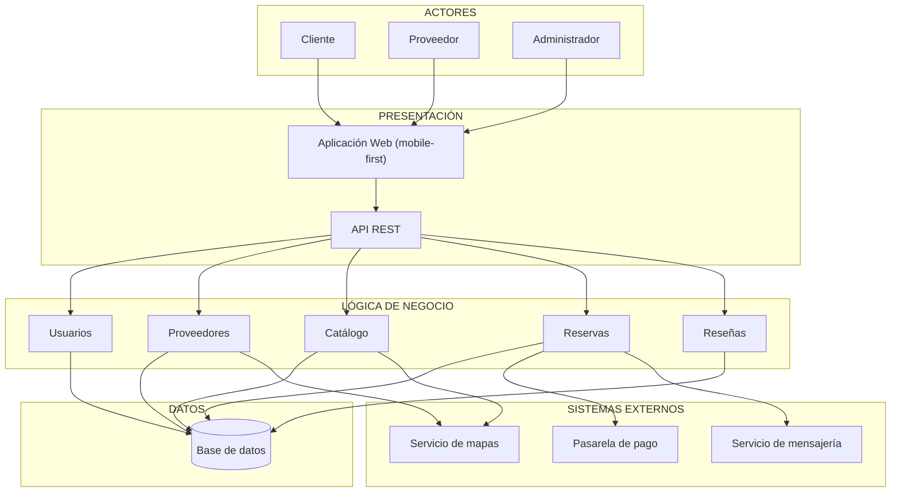

# Arquitectura inicial del sistema

## Ejercicio 09 - Arquitectura en capas

La arquitectura inicial de Qatu se organiza con una arquitectura de tres capas:

1. **Presentación**
2. **Lógica de negocio**
3. **Datos**

Cada capa tiene sus propias responsabilidades y se comunica solo con la capa inmediatamente inferior.

### Arquitectura en capas

### Descripción de las capas

| Capa                  | Pregunta que responde            |
| --------------------- | -------------------------------- |
| **Presentación**      | ¿Cómo interactúa el usuario?     |
| **Lógica de negocio** | ¿Qué hace el sistema?            |
| **Datos**             | ¿Dónde se almacena la información? |

#### Presentación

Es la capa encargada de la interacción con los usuarios. Está compuesta por la **Aplicación Web** (diseñada primero para celulares) y la **API REST**, mediante las cuales clientes, proveedores y administradores acceden a las funcionalidades de Qatu.

#### Lógica de negocio

Contiene los módulos que implementan las funcionalidades principales:

- **Usuarios:** registro, autenticación, perfiles y roles.
- **Proveedores:** registro, verificación y gestión de proveedores.
- **Catálogo:** herramientas y servicios de oficios, búsqueda y disponibilidad.
- **Reservas:** solicitudes de alquiler y contratación, estados, pagos y notificaciones.
- **Reseñas:** calificaciones y comentarios sobre los proveedores.

Esta capa procesa las solicitudes de la presentación y aplica las reglas de negocio, como evitar que una herramienta se reserve dos veces en las mismas fechas.

#### Datos

Es la capa responsable del almacenamiento y consulta de la información del sistema mediante una **base de datos relacional**.

---

# Ejercicio 10 - Diagrama final de arquitectura inicial

## Actores

Los principales actores que interactúan con el sistema son:

- Cliente
- Proveedor
- Administrador

## Sistemas externos

Qatu requiere integración con:

- Pasarela de pago
- Servicio de mensajería
- Servicio de mapas

## Diagrama de arquitectura

## Descripción

La arquitectura inicial de Qatu se organiza en tres capas principales:

- **Presentación:** contiene la Aplicación Web y la API REST, que permiten la interacción de clientes, proveedores y administradores con el sistema.
- **Lógica de negocio:** contiene los módulos de Usuarios, Proveedores, Catálogo, Reservas y Reseñas, responsables de las funcionalidades principales.
- **Datos:** contiene la base de datos relacional donde se almacena la información del sistema.

Además, la arquitectura contempla la integración con sistemas externos. El módulo de **Reservas** se comunica con la **pasarela de pago** (anticipos y garantías) y con el **servicio de mensajería** (notificaciones de estado). Los módulos de **Catálogo** y **Proveedores** usan el **servicio de mapas** para ubicar herramientas y proveedores cercanos.

---

# Decisión arquitectónica y tecnologías propuestas

## Estilo arquitectónico

Se propone una **arquitectura en tres capas implementada como monolito modular**: un solo despliegue, con los módulos de negocio separados internamente. Se eligió así por los siguientes drivers:

| Driver                                    | Cómo lo atiende el estilo elegido                                                                                  |
| ----------------------------------------- | ------------------------------------------------------------------------------------------------------------------ |
| **DA07** Modularidad y mantenibilidad     | Los módulos tienen límites claros y pueden evolucionar por separado.                                               |
| **DA01** Escalabilidad                    | Al ser una aplicación sin estado, se puede replicar detrás de un balanceador cuando crezca la demanda.             |
| **RC13 / RC14** Spec Kit y bajo costo     | Un solo despliegue es más simple de desarrollar con Spec Kit y más barato de operar al inicio.                     |
| **DA08** Consistencia de reservas         | Una sola base de datos relacional permite usar transacciones para evitar reservas en conflicto.                    |

Si Qatu crece, los módulos de Reservas o Catálogo podrían separarse como servicios independientes.

## Tecnologías propuestas por capa

> Propuesta inicial, sujeta a validación del equipo.

| Capa / elemento       | Tecnología propuesta                              | Relación con el análisis                                |
| --------------------- | ------------------------------------------------- | ------------------------------------------------------- |
| Aplicación Web        | Next.js (React) con TypeScript y Tailwind CSS     | RC01, RC10, AC06 (mobile-first, carga ligera)           |
| API REST              | Node.js con NestJS                                | RC03, RC11 (módulos por dominio)                        |
| Base de datos         | PostgreSQL (con PostGIS para búsqueda por zona)   | RC07, DA02 (búsquedas y cercanía)                       |
| Caché                 | Redis (opcional en una segunda etapa)             | DA02 (rendimiento)                                      |
| Autenticación         | JWT con roles (cliente, proveedor, administrador) | RC08, DA03                                              |
| Pasarela de pago      | Culqi, Niubiz o Mercado Pago (Yape/Plin, tarjetas)| RC04, DA04                                              |
| Mensajería            | WhatsApp Business API o SMS                       | RC05, DA06                                              |
| Mapas                 | Google Maps o OpenStreetMap                       | RC06, DA06                                              |
| Control de versiones  | Git y GitHub                                      | RC02                                                    |
| Despliegue            | Contenedores Docker en un servicio económico      | RC14, DA01                                              |

## Cambios respecto al caso de laboratorio (marketplace de mascotas)

| Laboratorio 2 (GoPet)                          | Qatu                                                              |
| ---------------------------------------------- | ----------------------------------------------------------------- |
| Compra de productos                            | Alquiler de herramientas y contratación de servicios              |
| Actor Seller                                   | Actor Proveedor                                                   |
| Módulos Carrito y Pedidos                      | Módulo Reservas (con calendario de disponibilidad)                |
| Sistemas externos: pago, envío, ERP, facturación | Sistemas externos: pago, mensajería, mapas                      |
| Driver de stock (ERP)                          | Driver de consistencia de reservas por fechas                     |
