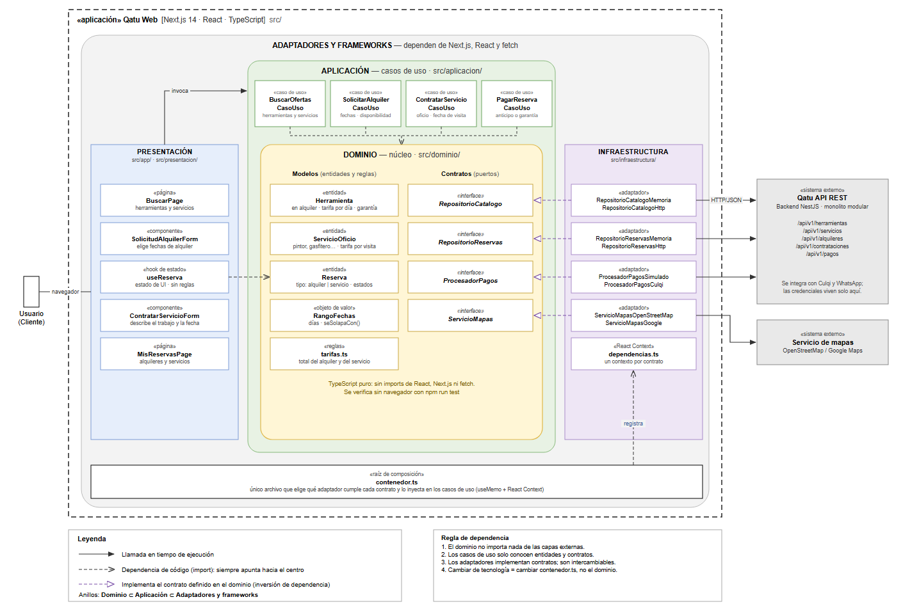

# 7. Patrones o enfoque arquitectónico

> **Pregunta guía:** ¿Cómo organizamos las dependencias internas del sistema?

Las dependencias internas se organizan mediante **Clean Architecture** (ADR-002).

| Elemento                            | Descripción aplicada a Qatu                                                                                                                                         |
| ----------------------------------- | ------------------------------------------------------------------------------------------------------------------------------------------------------------------- |
| **Patrón / enfoque arquitectónico** | Clean Architecture (Arquitectura Limpia).                                                                                                                           |
| **Objetivo**                        | Separar responsabilidades y controlar las dependencias hacia el dominio.                                                                                            |
| **¿Qué problema resuelve?**         | Evita el acoplamiento entre la interfaz Next.js, las reglas del negocio (tarifas, fechas y estados de reserva) y las tecnologías externas: API, pagos y mapas.      |
| **Capas definidas**                 | Presentación, Aplicación, Dominio e Infraestructura.                                                                                                                |
| **Beneficios**                      | • Facilita el mantenimiento y las pruebas unitarias. • Permite cambiar de pasarela de pago o de proveedor de mapas sin tocar el dominio (ADR-004, ADR-005). |

## Capas en el cliente web (`src/`)

| Capa                | Carpeta                                 | Contenido                                                                                                                         |
| ------------------- | --------------------------------------- | --------------------------------------------------------------------------------------------------------------------------------- |
| **Presentación**    | `src/app/` (rutas) y `src/presentacion/` | `BuscarPage`, `SolicitudAlquilerForm` (alquiler de herramientas), `ContratarServicioForm` (servicios de oficio), `MisReservasPage` y el hook de estado `useReserva` (sin reglas de negocio). |
| **Aplicación**      | `src/aplicacion/`                       | Casos de uso: `BuscarOfertasCasoUso`, `SolicitarAlquilerCasoUso`, `ContratarServicioCasoUso`, `PagarReservaCasoUso`.             |
| **Dominio**         | `src/dominio/`                          | Entidades (`Herramienta`, `ServicioOficio`, `Reserva`), objeto de valor `RangoFechas`, reglas (`tarifas.ts`) y contratos (puertos). |
| **Infraestructura** | `src/infraestructura/`                  | Adaptadores que implementan los contratos (memoria, HTTP, pagos, mapas) y `dependencias.ts`.                                      |

`contenedor.ts` es la **raíz de composición**: el único archivo que decide qué adaptador cumple cada contrato y lo inyecta en los casos de uso mediante un contexto de React.

### Elementos del dominio

| Elemento               | Tipo           | Responsabilidad                                                                                          |
| ---------------------- | -------------- | -------------------------------------------------------------------------------------------------------- |
| `Herramienta`          | Entidad        | Herramienta ofrecida en **alquiler** (taladro, andamio…), con tarifa por día, garantía, zona y calendario de disponibilidad. |
| `ServicioOficio`       | Entidad        | **Servicio de oficio** (pintor, gasfitero, electricista…), con tarifa por visita u hora y zona de atención. |
| `Reserva`              | Entidad        | Tipo `alquiler` (con `RangoFechas`) o `servicio` (con fecha de visita); estados `pendiente → aceptada → pagada → en curso → finalizada`, o `cancelada/rechazada`. |
| `RangoFechas`          | Objeto de valor | Número de días y verificación de solapamiento entre dos rangos (DA08); solo aplica al alquiler.         |
| `tarifas.ts`           | Reglas         | Alquiler: días × tarifa diaria + garantía. Servicio: tarifa por visita u hora. Comisión de la plataforma. |
| `RepositorioCatalogo`  | Contrato       | Buscar y obtener herramientas y servicios.                                                               |
| `RepositorioReservas`  | Contrato       | Registrar y consultar reservas.                                                                          |
| `ProcesadorPagos`      | Contrato       | Cobrar el anticipo o la garantía (ADR-004).                                                              |
| `ServicioMapas`        | Contrato       | Ubicar publicaciones y calcular cercanía (ADR-005).                                                      |

## Regla de dependencia

1. El dominio no importa nada de las capas externas (ni React, ni Next.js, ni `fetch`).
2. Los casos de uso solo conocen entidades y contratos.
3. Los adaptadores implementan contratos; son intercambiables.
4. Cambiar de tecnología = cambiar `contenedor.ts`, no el dominio.

## Diagrama: estructura interna del cliente web

