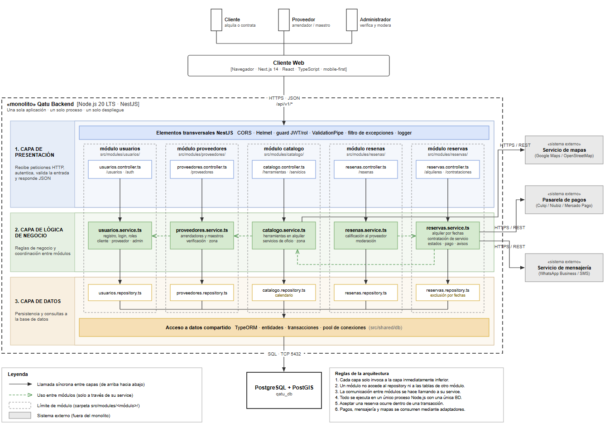
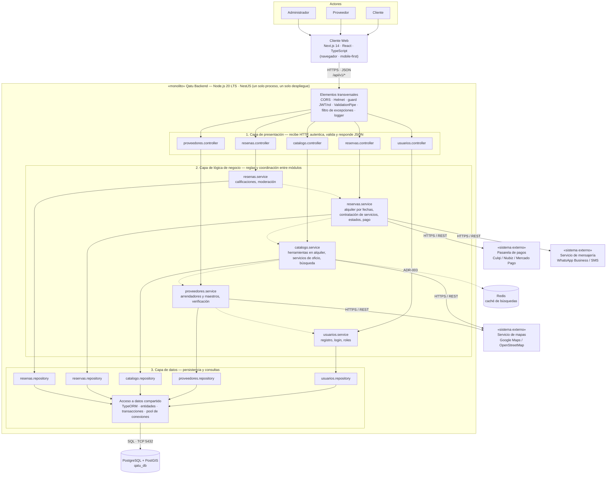
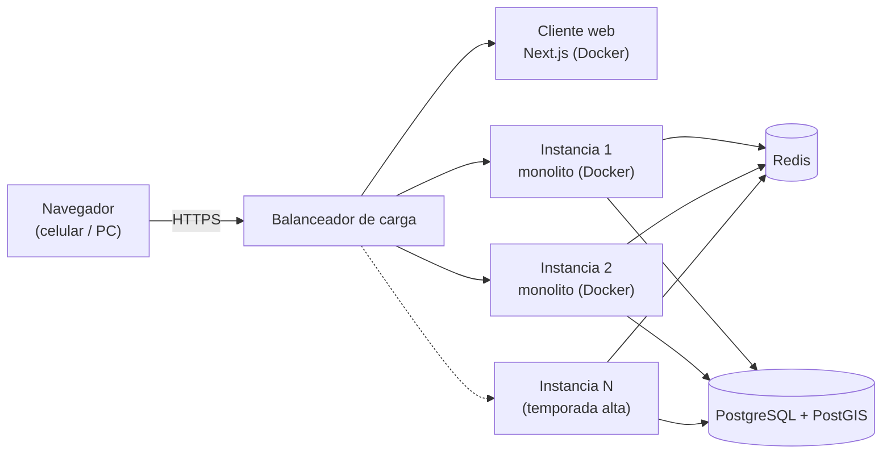

# 6. Estilo arquitectónico

> **Pregunta guía:** ¿Cómo estructuramos globalmente el sistema?

## Estilo seleccionado

**Cliente-servidor + Monolito modular en capas.**

| Concepto             | Qué significa en este proyecto                                                                                                                            |
| -------------------- | --------------------------------------------------------------------------------------------------------------------------------------------------------- |
| **Cliente-servidor** | El frontend (Next.js 14 · React · TypeScript) se ejecuta en el navegador del celular o computadora y consume el backend mediante API REST (HTTPS + JSON). |
| **Monolito**         | El backend (Node.js 20 + NestJS) es **una sola aplicación, un solo proceso, un solo despliegue** y una sola base de datos PostgreSQL (con PostGIS).       |
| **Modular**          | Dentro del monolito, cada funcionalidad es un módulo con límites claros: `usuarios`, `proveedores`, `catalogo`, `reservas`, `resenas`.                    |
| **En capas**         | Cada módulo se divide en presentación (controller), lógica de negocio (service) y datos (repository).                                                    |

> Capas = organización **lógica**. Monolito = unidad de **despliegue**.
> Ambos conceptos coexisten.

## Justificación (trazabilidad con drivers)

| Driver                                 | Cómo lo atiende el estilo                                                                                                                        |
| -------------------------------------- | ------------------------------------------------------------------------------------------------------------------------------------------------ |
| DA01 – Escalabilidad                   | El monolito no guarda sesión (JWT), así que se replica detrás de un balanceador; un módulo como `reservas` podría extraerse si lo necesita.       |
| DA02 – Rendimiento                     | Caché (Redis) frente al módulo `catalogo`; índices geográficos (PostGIS) para buscar por zona; llamadas en proceso, sin latencia entre módulos. |
| DA03 – Seguridad                       | Guardas transversales de autenticación (JWT) y rol, validación de entrada y HTTPS (ADR-007).                                                     |
| DA04 – Pago externo                    | El módulo `reservas` se integra con la pasarela mediante un adaptador HTTPS/REST (ADR-004).                                                      |
| DA05 – API REST                        | Frontend y backend separados; contrato `/api/v1/*`.                                                                                              |
| DA06 – Mensajería y mapas              | Adaptadores para WhatsApp/SMS y mapas; si fallan, la reserva continúa (ADR-005).                                                                |
| DA07 – Modularidad y mantenibilidad    | Módulos independientes; cada módulo solo usa a otro a través de su _service_.                                                                    |
| DA08 – Consistencia de reservas        | Una sola base de datos relacional permite transacciones y restricciones de exclusión por fechas (ADR-006).                                      |
| DA09 – Usabilidad móvil                | Next.js con renderizado en servidor y respuestas paginadas (ADR-008).                                                                            |

## Alternativas descartadas

| Estilo            | Motivo                                                                                                                         |
| ----------------- | ------------------------------------------------------------------------------------------------------------------------------ |
| Microservicios    | Alto costo operativo para un equipo pequeño y un presupuesto limitado (RC14); además complica la consistencia de las reservas. |
| SOA / ESB         | Pensado para integrar muchos sistemas corporativos; excesivo para Qatu.                                                        |
| Event-driven puro | Útil para notificaciones asíncronas (se puede incorporar luego), pero no como estructura global.                              |
| Serverless        | Dificulta las transacciones de reserva y genera dependencia del proveedor cloud.                                               |

## Diagrama de arquitectura (estructura global)

Versión en Mermaid (incluye además la caché Redis del ADR-003):

**Leyenda**

- Flecha continua: llamada síncrona entre capas (de arriba hacia abajo).
- Flecha punteada entre services: uso entre módulos (solo a través de su _service_).
- Cilindros: almacenamiento. Cajas «sistema externo»: fuera del monolito.

### Dependencias entre módulos

| Módulo que usa | Módulo usado  | Motivo                                                                    |
| -------------- | ------------- | ------------------------------------------------------------------------- |
| `proveedores`  | `usuarios`    | Todo proveedor es un usuario registrado con rol de proveedor.             |
| `catalogo`     | `proveedores` | Solo un proveedor verificado puede publicar herramientas o servicios.     |
| `reservas`     | `catalogo`    | Consulta la tarifa y el calendario de la herramienta (alquiler) o la tarifa del servicio de oficio (contratación). |
| `resenas`      | `reservas`    | Solo se puede reseñar a un proveedor después de una reserva finalizada.   |

## Estructura interna del cliente web (Next.js)

El nodo **Cliente Web** del diagrama anterior se organiza internamente con
Clean Architecture: Presentación, Aplicación (casos de uso), Dominio e
Infraestructura (adaptadores), con `contenedor.ts` como raíz de composición.
Los adaptadores HTTP consumen la **Qatu API REST** del monolito.

## Reglas de la arquitectura

1. Cada capa solo invoca a la capa inmediatamente inferior.
2. Un módulo no accede al _repository_ ni a las tablas de otro módulo.
3. La comunicación entre módulos se hace llamando a su _service_.
4. Todo se ejecuta en un único proceso Node.js con una única base de datos.
5. Los sistemas externos (pagos, mensajería, mapas) se consumen siempre mediante adaptadores (ADR-004, ADR-005).
6. Aceptar una reserva siempre ocurre dentro de una transacción (ADR-006).

## Despliegue

La aplicación es **una sola imagen** que se replica; escalar en temporada alta
es levantar más instancias, sin cambiar código (DA01). En la etapa inicial basta
con una instancia en un servicio económico (RC14).
