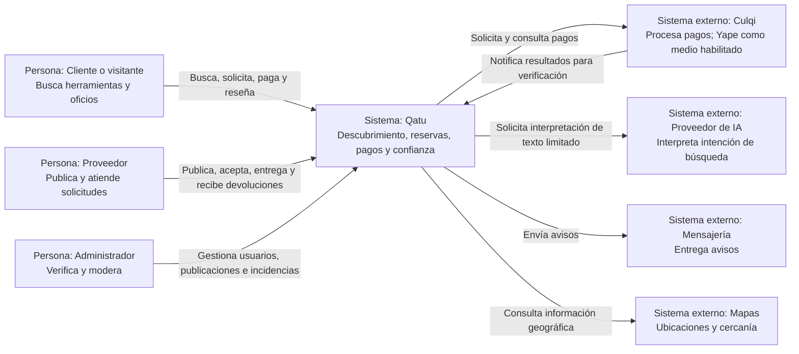

# Nivel 1 - Contexto del sistema Qatu

## Objetivo y alcance

Mostrar Qatu como un sistema: personas y servicios externos. MVP: alquiler de herramientas y contratación de oficios en Ayacucho, con pago mediante pasarela y búsqueda en lenguaje natural. Compraventa y custodia propia de garantías quedan fuera del MVP.

## Personas

| Persona | Operaciones | Límite |
|---|---|---|
| Visitante | Búsqueda, detalle y filtros interpretados | No reserva ni paga sin autenticarse |
| Cliente | Solicitud, pago, seguimiento y reseña | Accede solo a operaciones propias |
| Proveedor | Publicación, calendario, aceptación y entrega/devolución | Accede a recursos y solicitudes de su oferta |
| Administrador | Verificación, moderación e incidencias | Acciones auditadas y permisos explícitos |

Una cuenta puede ser cliente y proveedor. El proveedor puede ofrecer herramientas, servicios o ambos.

## Relaciones externas

Culqi es la pasarela candidata del MVP. Yape es un medio de pago ofrecido por su integración, sujeto a habilitación de cuenta y pruebas. El proveedor de IA devuelve intención, no datos autoritativos. Mensajería y mapas no deciden disponibilidad ni estado de una reserva.

No hay ERP, courier ni servicio de facturación heredados automáticamente del ejemplo de mascotas. Una constancia de operación interna no se presenta como comprobante tributario. No se incluyen tecnologías internas ni servidores en esta vista.

## Trazabilidad

RF01-RF23; DA03, DA04, DA06, DA10; ADR-004, ADR-005, ADR-007, ADR-009.

[Nivel 2](./Nivel2-DiagramadeContenedores.md) · [Actores](../01-analisis-de-sistema/01-actores.md).
