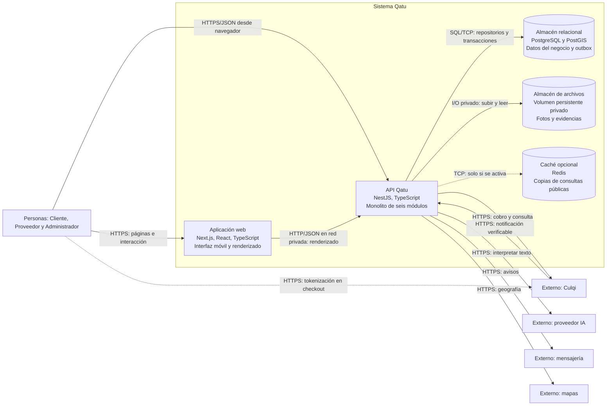

# Nivel 2 - Contenedores de Qatu

## Objetivo

Abrir Qatu en aplicaciones y almacenes independientes. Contenedor C4 no significa necesariamente contenedor Docker. El navegador ejecuta la interfaz y Next.js sirve/renderiza páginas; la API NestJS conserva la autoridad del negocio.

## Responsabilidades y datos

| Contenedor | Responsabilidad | Datos |
|---|---|---|
| Web Next.js | Búsqueda, paneles, reservas y filtros editables | Estado de interfaz; ninguna autoridad sobre pago/fechas |
| API NestJS | Reglas, permisos, búsqueda y adapters | Usa repositorios; ejecuta publicación outbox interna |
| PostgreSQL | Transacciones, restricciones y persistencia | Usuarios, proveedores, catálogo, reservas, pagos, confianza y eventos |
| Archivos | Fotografías y evidencias privadas | Binarios; BD guarda metadata y referencia |
| Redis opcional | Acelerar consultas públicas | Copias temporales; nunca decide aceptación |

Fotos del catálogo se exponen mediante ruta controlada. Evidencias requieren permiso por reserva y URL temporal o streaming autorizado. Se puede sustituir volumen por almacenamiento S3 compatible mediante AlmacenEvidencias sin cambiar reglas.

## Seguridad y pagos

HTTPS termina en proxy; base de datos y caché no publican puertos a Internet. La red privada inicial permite HTTP interno web/API; al separar hosts, revisar cifrado. Tokenización ocurre en checkout del proveedor con llave pública. La llave privada solo existe en API; el token llega al servidor, que calcula y solicita el cobro. La respuesta visual del checkout no confirma la reserva.

## Decisiones

ADR-001: backend único; ADR-002: capas internas; ADR-003: Redis opcional; ADR-004/ADR-011: pagos verificados; ADR-009: IA externa por puerto de lectura; ADR-010/ADR-012: persistencia y copias externas. pgvector y worker independiente son evolución, no contenedores activos del MVP.

[Nivel 1](./Nivel1-DiagramadeContextodelSistema.md) · [Nivel 3](./Nivel3-Diagrama-de-Componentes.md) · [Despliegue](./despliegue-vps.md).
