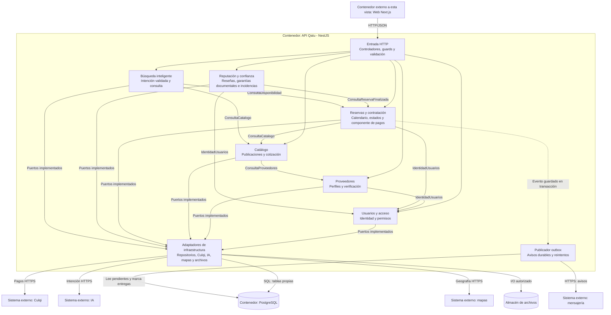

# Nivel 3 - Componentes de la API Qatu

## Objetivo

Detallar exclusivamente el contenedor API del nivel 2. Los seis módulos se ejecutan juntos; componentes técnicos transversales no se cuentan como módulos de negocio adicionales.

## Componentes, interfaces y propiedad

| Módulo | Contrato público | Propiedad |
|---|---|---|
| usuarios | IdentidadUsuarios | Cuentas, roles y permisos |
| proveedores | ConsultaProveedores | Perfiles, verificación y zona |
| catalogo | ConsultaCatalogo | Publicaciones, recursos físicos y tarifa |
| reservas | ConsultaDisponibilidad; casos de uso de solicitudes/pagos | Bloqueos, operaciones, intentos y eventos de pago |
| resenas | RegistroConfianza | Evidencias, garantías documentales, incidencias y reseñas |
| busqueda | BuscarEnLenguajeNatural | Criterios interpretados y métricas de consumo |

El componente de pagos pertenece a reservas y es único responsable de Culqi. InterpreteIntencion pertenece a busqueda. El adaptador de mapas es compartido como infraestructura, con un único puerto; no duplica lógica por módulo. Catálogo y confianza usan AlmacenEvidencias con políticas distintas de acceso.

## Reglas

1. index.ts publica solo contratos/fachadas; no repositories o entidades ORM.
2. Cada módulo opera sus tablas. Shared contiene utilidades puras y adapters transversales, no un repositorio universal.
3. Llamadas internas son en proceso, no REST entre módulos.
4. Reservas no depende de IA; Búsqueda depende de lectura de Reservas.
5. Outbox y consumidores se ejecutan inicialmente dentro de API; un worker independiente requerirá actualizar nivel 2.
6. Eventos se publican después del commit, con deduplicación; no asumir entrega exactamente una vez.
7. Transacciones de aceptación y confirmación pertenecen a Reservas; evidencia se registra en confianza y se coordina mediante eventos/API pública, sin transacción externa ficticia.

## Trazabilidad

DA07/ADR-001/ADR-002 → límites. DA08/ADR-006 → calendario. DA04/DA12/ADR-004/ADR-011 → pago. DA10/ADR-009 → lectura con IA.

[Nivel 2](./Nivel2-DiagramadeContenedores.md) · [Nivel 4](./Nivel4-DiagramadeCodigo.md) · [Diseño interno](../03-diseño-de-software/diseño-interno/diseño-interno-de-modulos.md).
