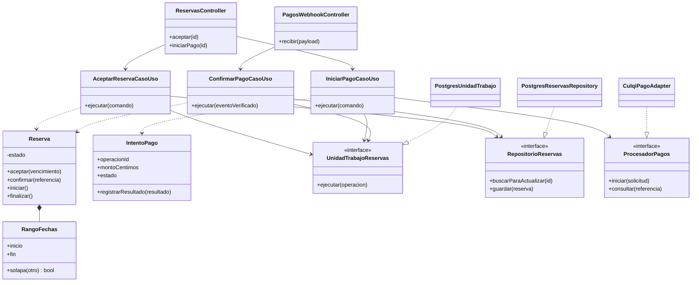
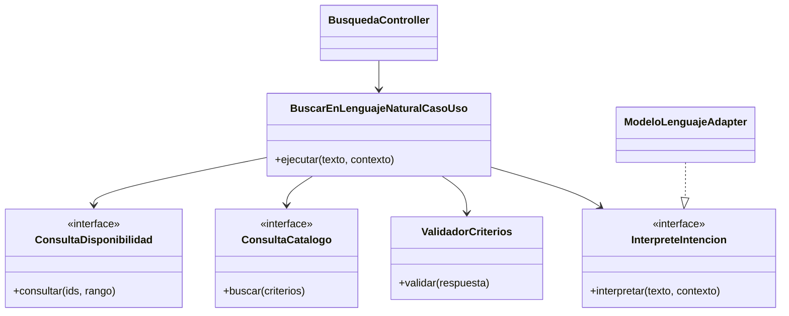
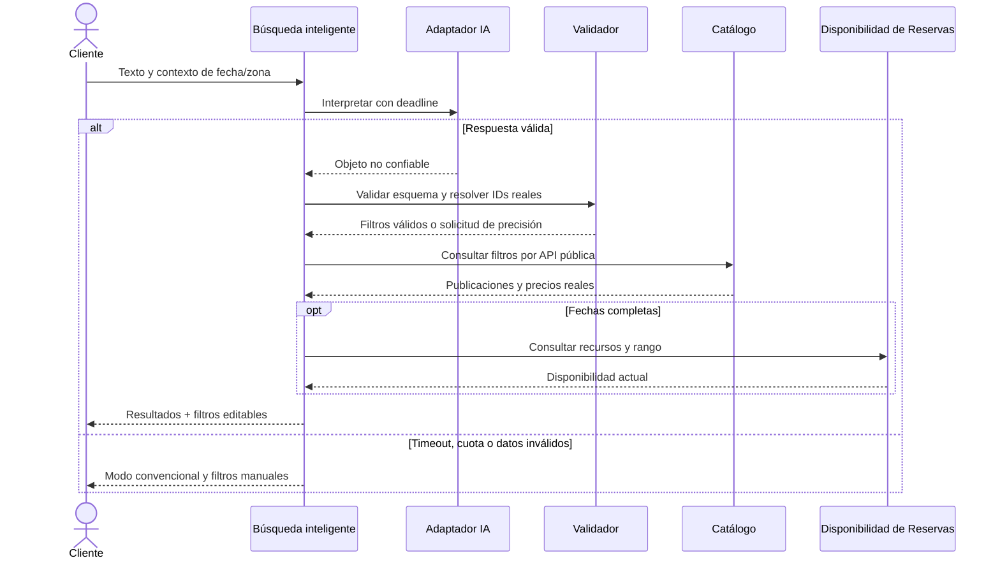

# Nivel 4 - Código de Reservas y Búsqueda inteligente

## Objetivo y estado

Detallar clases e interfaces de los componentes críticos del nivel 3. Notación UML mediante Mermaid. Es código diseñado, todavía no implementado. Pagos es un componente interno de Reservas.

## Clases de Reservas y pagos



Asociación: -->; dependencia: ..>; realización: ..|>; composición: *--. Puerto de pagos y repositorio no importan sus implementaciones. Unidad de trabajo conecta repositorios transaccionales de Reserva, IntentoPago, Inbox y Outbox; no se omiten del diseño financiero aunque no se dibujen todas las clases auxiliares.

## Secuencia: aceptar y pagar

```mermaid
sequenceDiagram
    actor Proveedor
    actor Cliente
    participant API as API Qatu
    participant R as Casos de uso Reservas
    participant DB as PostgreSQL
    participant P as Adaptador Culqi
    participant C as Culqi
    Proveedor->>API: Aceptar solicitud propia
    API->>R: AceptarReservaCasoUso
    R->>DB: Transacción: reserva + bloqueo + outbox
    alt Rango ocupado
        DB-->>R: Restricción de exclusión
        R-->>API: Conflicto 409
    else Rango libre
        DB-->>R: Commit ACEPTADA con vencimiento
        R-->>API: Reserva aceptada
        Cliente->>API: Iniciar pago con token y clave de operación
        API->>R: IniciarPagoCasoUso
        R->>DB: Guardar intento y monto autoritativo; commit
        R->>P: iniciar(intento persistido)
        P->>C: Solicitar cobro sin transacción SQL abierta
        alt Resultado verificable inmediato
            C-->>P: Referencia y estado
            P-->>R: Resultado normalizado
            R->>DB: Guardar resultado; confirmar si evidencia verificada
        else Timeout o pendiente
            P-->>R: DESCONOCIDO o PENDIENTE
            R->>DB: Guardar estado y tarea de conciliación
            R-->>API: 202; consultar estado
        end
        C->>API: Notificación del pago
        API->>P: Verificar evento según proveedor
        opt Requiere consultar recurso externo
            P->>C: Consultar con credencial privada
            C-->>P: Estado, monto, moneda y referencia
        end
        P-->>API: Evento verificado
        API->>R: ConfirmarPagoCasoUso
        R->>DB: Transacción: inbox único + intento + reserva + outbox
        alt Duplicado
            DB-->>R: Ya procesado; sin nuevo efecto
        else Reserva vigente y pago válido
            DB-->>R: Commit CONFIRMADA
        else Reserva vencida o importe incorrecto
            DB-->>R: Registrar recepción sin confirmar; conciliación
        end
        R-->>API: Resultado persistido
        API-->>C: Acuse después de persistir
    end
```

Una respuesta aprobada verificada y un webhook recorren la misma lógica idempotente. Para reservas vencidas, el pago no vuelve a bloquear fechas: se gestiona ajuste/reembolso. El publicador procesa outbox después del commit y registra entregas; no está dentro del cobro. No se borra el intento rechazado.

## Clases de búsqueda inteligente



## Secuencia: búsqueda natural



No se consulta disponibilidad cuando faltan fechas; la interfaz indica que debe especificarlas. Ninguna flecha de búsqueda ejecuta pago o reserva.

## Verificación

EQ-05: imports y sustitución. EQ-07: exclusión con BD real. EQ-08: eventos y pagos inciertos. EQ-10: filtros/resultados autorizados.

[Nivel 3](./Nivel3-Diagrama-de-Componentes.md) · [Diseño interno](../03-diseño-de-software/diseño-interno/diseño-interno-de-modulos.md).
