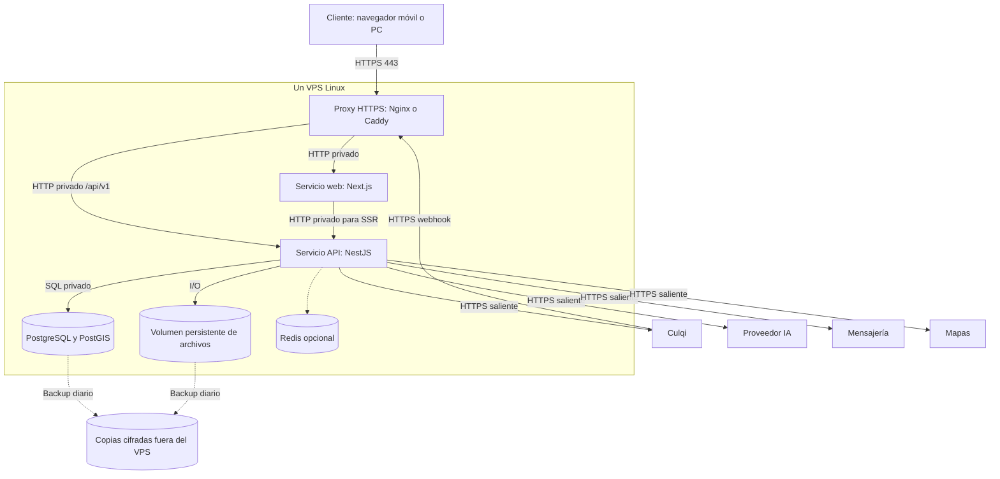

# Despliegue inicial de Qatu en VPS

## Alcance

Vista de despliegue complementaria a C4. Un VPS Linux con Docker Compose; seis módulos en una API NestJS, web Next.js y PostgreSQL. Redis opcional. Configuración operativa propuesta; no es un despliegue realizado.

## Operación y límites

| Elemento | Diseño |
|---|---|
| Puertos públicos | 443; 80 solo para redirección/certificado; SSH restringido |
| Puertos privados | Web, API, PostgreSQL y Redis sin publicación pública |
| Persistencia | Volúmenes para BD y archivos; reconstruir imagen no elimina datos |
| Secretos | Variables/archivos protegidos fuera de Git; llave pública de checkout separada de privada |
| Salud | Liveness del proceso; readiness con DB; fallo IA no invalida disponibilidad de reservas |
| Reinicio | Política de reinicio del servicio; no reemplaza recuperación del host |
| Observabilidad | Logs JSON con correlationId, métricas de latencia/error y alertas de backups/pagos desconocidos |
| Copias | Diarias, cifradas y externas; retención propuesta 7 diarias y 4 semanales; restauración ensayada |
| Despliegue | Imagen etiquetada por commit; migraciones controladas; rollback compatible con esquema |

No dimensionar con números inventados: escoger VPS después de prueba EQ-01/EQ-03 y registrar costo, RAM, CPU, disco y límites. EQ-09 propone RPO de 24 h y RTO de 4 h; pagos posteriores a la copia requieren conciliación externa.

## Secuencia de publicación

1. Construir imágenes, verificar configuración y ejecutar pruebas críticas.
2. Respaldar DB/archivos y comprobar espacio.
3. Aplicar migraciones compatibles, publicar imágenes y verificar readiness.
4. Ejecutar smoke test de búsqueda, reserva, permisos y pago sandbox.
5. Si falla, volver a imagen anterior solo si es compatible con el esquema; restaurar bajo procedimiento cuando corresponda.

## Evolución

Primero optimizar consultas y medir. Después evaluar más recursos o réplicas de API con almacenamiento compartido. Réplicas dentro del mismo host no ofrecen alta disponibilidad ante caída de VPS. Extraer IA solo si existe necesidad demostrada de carga/despliegue independiente; preservar contratos, costos y seguridad.

[Contenedores](./Nivel2-DiagramadeContenedores.md) · [Escenarios](../01-analisis-de-sistema/08-escenarios-atributos-calidad.md).
